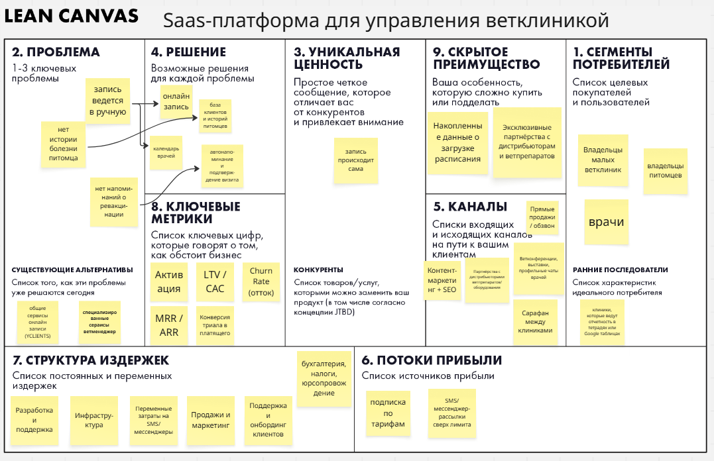

# VetFlow — SaaS-платформа для управления ветеринарной клиникой

> **ДЗ 1. Lean Canvas и Elevator Pitch**
> Модуль «Методы разработки ПО», VK Education.

VetFlow — лёгкая платформа онлайн-записи для ветеринарных клиник. Она снимает с администратора рутину записи: расписание заполняется само, а администратор занимается клиентами, а не телефоном.

---

## 🎤 Elevator Pitch

**Полная версия:**

> Для владельцев малых и средних ветеринарных клиник, чьи администраторы тонут в звонках и ручной записи, **VetFlow** — это лёгкая платформа онлайн-записи, которая заполняет расписание без участия администратора 24/7 и автоматически напоминает клиентам о визитах. В отличие от тяжёлых ветеринарных CRM и универсальных сервисов записи, VetFlow решает одну задачу — разгружает администратора — и настраивается за 5 минут без обучения.

**Короткая версия:**

> **VetFlow — меньше звонков, больше записей.**
> Лёгкая онлайн-запись для ветеринарных клиник: расписание заполняется само, администратор занимается клиентами, а не телефоном.

---

## 📋 Lean Canvas

## 🖼 Lean Canvas (скриншот из Miro)

### 1. Проблема

1. **Администратор тонет в телефоне и ручной записи.** Запись в тетради/Excel, двойные записи, пропущенные звонки в час пик → потерянные клиенты и выгорание персонала.
2. **Нет единой базы и истории питомцев.** Врач не видит прошлые визиты и назначения, между сменами и врачами нет преемственности → приём идёт медленнее, доверия клиента меньше.
3. **Пустые слоты и неявки (no-show).** Вечером и в выходные записаться по телефону нельзя, напоминаний нет → клиенты записываются и не приходят или уходят в другую клинику. При тех же затратах клиника недополучает выручку.

**Существующие альтернативы:**

- *Ручной уровень:* бумажный журнал / тетрадь записи, Excel / Google Sheets, телефон + WhatsApp/Telegram.
- *Универсальные сервисы записи:* YCLIENTS, Dikidi, Altegio, Битрикс24.
- *Специализированные ветеринарные системы (тяжёлые комбайны):* Ветменеджер (Vetmanager), ENOTE, VetAIS, VETWare, Get Well, VetSoft, Vet.AF, 1С:Ветеринария.
- *Чат-боты для записи* (Telegram / VK / WhatsApp).

### 2. Сегменты потребителей

- **Основной клиент:** владелец / управляющий малой и средней ветклиники (**1–15 врачей**), возможно с 1–2 филиалами.
- **Кто платит:** клиника (руководитель).
- **Кто пользуется:** администратор, врачи и владельцы питомцев.

**Ранние последователи:** клиники, которые уже ведут запись в Google-таблицах или простых сервисах и реально ощущают боль с расписанием и звонками.

### 3. Уникальная ценность (UVP)

> **VetFlow — платформа для ветклиник, которая снимает с администратора рутину записи: онлайн-бронирование 24/7 и автонапоминания заполняют расписание без звонков.**

Позиционирование: **не полноценная вет-CRM, а лёгкий инструмент разгрузки администратора.** Мы не конкурируем с Ветменеджером по функционалу, а бьём в сегмент «малая клиника + простая запись + быстрое внедрение».

**Конкуренты:** Ветменеджер, ENOTE, VetAIS, VETWare, 1С:Ветеринария; универсальные YCLIENTS, Dikidi; чат-боты для записи.

### 4. Решение

| Фича | Какую проблему закрывает |
|---|---|
| Онлайн-запись + календарь врачей (виджет на сайт и в соцсети) | перегруженный администратор + пустые слоты |
| Карточки питомцев и база клиентов (история, прививки, назначения) | нет единой истории |
| Автонапоминания и подтверждение визита (SMS / мессенджер) | неявки и незаполненное расписание |

### 5. Каналы

1. **Партнёрства с дистрибьюторами ветпрепаратов/оборудования** — у них уже есть база клиник и доверие (сильнейший канал).
2. **Прямые продажи / обзвон** — активный канал на старте.
3. **Ветконференции, выставки, профильные чаты врачей** (Telegram / VK).
4. **Контент-маркетинг + SEO** («как автоматизировать запись в ветклинике»).
5. **Сарафан между клиниками** — владельцы в регионах общаются друг с другом.

### 6. Потоки прибыли

| Тариф | Кому | Что внутри | Цена |
|---|---|---|---|
| **Старт** | 1–3 врача | онлайн-запись + календарь + напоминания | ~1 900 ₽/мес |
| **Про** | до 8 врачей | + карточки питомцев, аналитика, брендированный виджет | ~3 900 ₽/мес |
| **Сеть** | до 20 врачей / филиалы | + мультифилиалы, роли, отчёты | ~6 900 ₽/мес |

Дополнительно:
- **SMS / мессенджер-рассылки сверх лимита** — оплата по факту.
- **Годовая подписка со скидкой** — для предсказуемого денежного потока.

### 7. Структура издержек

1. **Разработка и поддержка** — зарплаты команды (крупнейшая статья).
2. **Инфраструктура** — облако, серверы, БД, хостинг.
3. **Переменные затраты на SMS / мессенджеры** — растут вместе с клиентами.
4. **Продажи и маркетинг** — обзвон, партнёрские комиссии, контент.
5. **Поддержка и онбординг клиентов** — настройка виджета, обучение админов.
6. **Прочее** — бухгалтерия, налоги, юрсопровождение.

### 8. Ключевые метрики

1. **MRR / ARR** — повторяющаяся выручка.
2. **Churn Rate (отток)** — % клиник, отказавшихся за месяц.
3. **LTV / CAC** — соотношение ценности клиента к стоимости привлечения (цель > 3).
4. **Конверсия триала в платящего.**
5. **Активация** — клиника поставила виджет и приняла первую онлайн-запись.

### 9. Скрытое преимущество

1. **Эксклюзивные партнёрства с дистрибьюторами ветпрепаратов** — канал строится на отношениях, конкурентам его скопировать тяжело.
2. **Накопленные данные о загрузке расписания** — чем больше клиник, тем точнее прогноз заполняемости и подсказки по «окнам».

---

