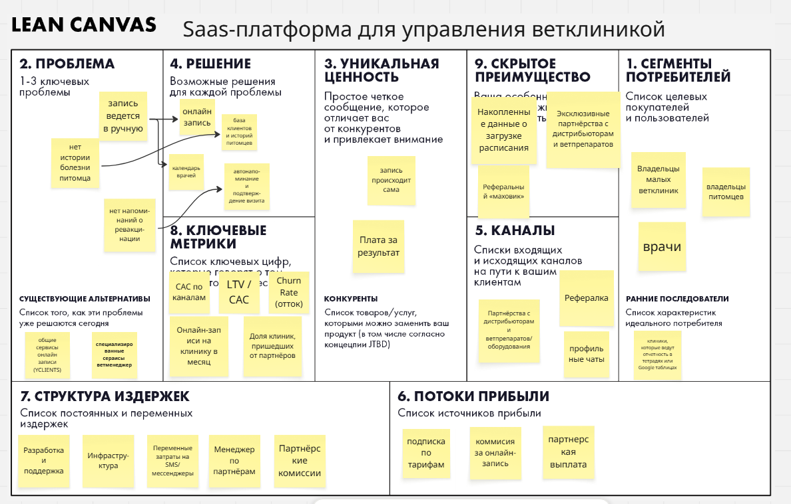

# ДЗ 2. Гипотезы и юнит-экономика

> **Проект:** VetFlow — лёгкая платформа онлайн-записи для ветеринарных клиник.
> Модуль «Методы разработки ПО», VK Education.

---

## 1. Самый критичный риск и HADI-гипотеза

### Какой риск выбран и почему

Из четырёх продуктовых рисков по Марти Кагану для VetFlow самый критичный — **риск жизнеспособности (Viability risk)**: сойдётся ли экономика.

| Риск | Оценка для VetFlow |
|---|---|
| Ценность (Value) | Средний. Спрос на автоматизацию записи в ветклиниках уже подтверждён рынком (Ветменеджер — 2100+ клиник, YCLIENTS). Остаётся вопрос «купят ли нас», но это не главный убийца. |
| **Жизнеспособность (Viability)** | **Высокий.** Чек низкий (подписка ~1 900–6 900 ₽/мес), а B2B-продажи в клиники требуют обзвона, демо и онбординга. Если CAC окажется выше LTV/3 — масштабирование будет только умножать убытки (кейсы MoviePass и Dropbox из лекции). |
| Осуществимость (Feasibility) | Низкий. Онлайн-запись и календарь — технически несложно. |
| Юзабилити (Usability) | Низкий. Интерфейс для администратора простой по задумке. |

Затрагиваемые блоки Lean Canvas: **«Потоки прибыли»** и **«Структура издержек»**.

### HADI-гипотеза

> **(H) Гипотеза.** Мы верим, что малую ветклинику можно привлекать через партнёрскую сеть дистрибьюторов ветпрепаратов дешевле, чем за 1/3 её LTV (LTV ≈ 33 750 ₽ ⇒ CAC < 11 000 ₽), а не только дорогим прямым обзвоном.
>
> **(A) Действие.** Запускаем пилот на 60 дней: договариваемся с 3 дистрибьюторами, чтобы они рекомендовали VetFlow своей базе клиник, и параллельно держим контрольный тест платного трафика на 30 000 ₽. Считаем, сколько клиник дошло до оплаты по каждому каналу.
>
> **(D) Данные.** Замеряем **CAC по каналам** = (затраты канала) / (число платящих клиник), а также конверсию «рекомендация партнёра → оплата».
>
> **(I) Вывод.** Если CAC в партнёрском канале **< 11 000 ₽** (и он даёт ≥ 10 клиник за 60 дней) — гипотеза жизнеспособности подтверждена, масштабируем партнёров. Если CAC ≥ 11 000 ₽ или партнёры не дают объём — экономика не сходится, переходим к **Pivot** (см. раздел 3).

---

## 2. Базовая юнит-экономика

**Юнит:** 1 платящая клиника (B2B-подписка, 1 контракт).

### 2.1. Воронка привлечения и CAC

Базовый сценарий — платный трафик (Яндекс.Директ на владельцев клиник):

| Этап | Значение | Расчёт |
|---|---|---|
| Стоимость клика (CPC) | 120 ₽ | — |
| Клики | 1 000 | — |
| Бюджет на трафик | **120 000 ₽** | 1 000 × 120 ₽ |
| Конверсия клик → лид (триал/демо) | 4 % | 40 лидов |
| Цена лида | 3 000 ₽ | 120 000 / 40 |
| Конверсия лид → платящий клиент | 15 % | 6 клиентов |
| **CAC** | **20 000 ₽** | 120 000 / 6 |

> CAC ≠ стоимость клика: между кликом и оплатой сидят конверсии в лид и в покупку. В CAC также входят зарплаты продаж и инструменты (CRM, рассылки), а не только реклама.

### 2.2. LTV

Юнит — подписка, поэтому «частота покупок» = ежемесячный платёж.

| Параметр | Значение |
|---|---|
| Средний чек (ARPU) | 2 500 ₽/мес |
| Маржинальность (после хостинга, SMS, поддержки) | 75 % |
| Прибыль с клиента в месяц | 1 875 ₽ |
| Средний срок жизни клиента | 18 мес |
| **LTV** | **33 750 ₽** |

**Формула (как в лекции):** `LTV = прибыль с одной «сделки» × количество сделок за жизнь` = 1 875 ₽ × 18 мес = **33 750 ₽**.

### 2.3. Сходимость экономики

| Показатель | Значение |
|---|---|
| LTV | 33 750 ₽ |
| CAC (платный трафик) | 20 000 ₽ |
| **LTV / CAC** | **1,69** |
| Порог «золотого стандарта» | LTV / CAC ≥ 3 |

**Вывод: экономика в базовом сценарии НЕ сходится.** 1,69 — это меньше 3: компания выживает, но не может расти: маркетинг почти окупает себя, а на найм и разработку денег не остаётся. Причина — дорогой платный трафик при низком чеке (та же ловушка, что у Dropbox с Google Ads: LTV $120 против CAC $300).

---

## 3. План Б: Pivot

Так как базовая математика не сошлась — делаем **Pivot** (не новый стартап, а смена модели с переиспользованием продукта).

### 3.1. Основной Pivot: Channel + Engine of Growth

**Channel Pivot** (смена канала дистрибуции) + **Engine of Growth Pivot** (смена драйвера роста с платного трафика на партнёрско-реферальный):

- Отказываемся от прямой закупки трафика.
- Продаём только через дистрибьюторов ветпрепаратов (у них уже есть база клиник и доверие).
- Запускаем реферальную программу «клиника приводит клинику» (как «give space, get space» у Dropbox).

**Пересчёт после пивота:**

| Параметр | Значение |
|---|---|
| Партнёрская выплата за клинику | 5 000 ₽ |
| Менеджер по партнёрам (60 000 ₽/мес на 20 клиник) | 3 000 ₽/клиника |
| **CAC после пивота** | **8 000 ₽** |
| LTV | 33 750 ₽ |
| **LTV / CAC** | **4,2** ✅ |

Пивот делает экономику сходящейся: **LTV/CAC = 4,2** — в зоне золотого стандарта (3–5).

### 3.2. Резервный Pivot (если партнёры не дадут объём)

**Revenue Pivot** (смена монетизации): вместо чистой подписки — гибрид **«подписка + комиссия за онлайн-запись»** (транзакционная модель). Плюсы:

- LTV растёт вместе с реальной пользой: загруженная клиника платит больше, а цена привязана к ценности.
- CAC не растёт, а LTV становится выше и «честнее».

Дополнительный резерв — **Customer Segment Pivot**: уйти от малых клиник к средним/сетевым (чек 6 900 ₽, ниже относительный CAC), но там выше конкуренция с Ветменеджером.

### 3.3. Какой пивот считаем основным

| Тип пивота (из лекции) | Применение в VetFlow |
|---|---|
| **Channel Pivot** | Переход с прямого трафика на партнёрскую сеть дистрибьюторов |
| **Engine of Growth Pivot** | С платной закупки трафика → на реферальный рост |
| Revenue Pivot (резерв) | Подписка → гибрид «подписка + комиссия за запись» |
| Customer Segment Pivot (резерв) | Малые клиники → средние/сетевые |

### 3.4. Lean Canvas пивота

Второй Lean Canvas (для бизнес-модели после пивота) заполнен в Miro. Ключевые отличия от исходного канваса:

- **UVP:** «запись происходит сама» → **«плата за результат»**;
- **Каналы:** платный трафик убран, остались **партнёрства с дистрибьюторами, рефералка и профильные чаты**;
- **Потоки прибыли:** добавлены **комиссия за онлайн-запись** и партнёрская выплата;
- **Издержки:** вместо маркетинга — **партнёрские комиссии** и менеджер по партнёрам;
- **Метрики:** добавлены **онлайн-записи на клинику в месяц** и **доля клиник, пришедших от партнёров**.

---

## Приложение: допущения

Все цифры — проверяемые гипотезы, а не факты:

- ARPU 2 500 ₽/мес — средневзвешенная цена трёх тарифов (Старт 1 900 / Про 3 900 / Сеть 6 900).
- Маржинальность 75 % — оценка после хостинга, SMS и поддержки.
- Срок жизни 18 мес — консервативная оценка для SMB-SaaS (churn ~5,5 %/мес).
- CPC 120 ₽ и конверсии 4 % / 15 % — оценки для узкого B2B-сегмента, требуют проверки на пилоте.

Именно эти допущения и проверяет HADI-гипотеза из раздела 1.
